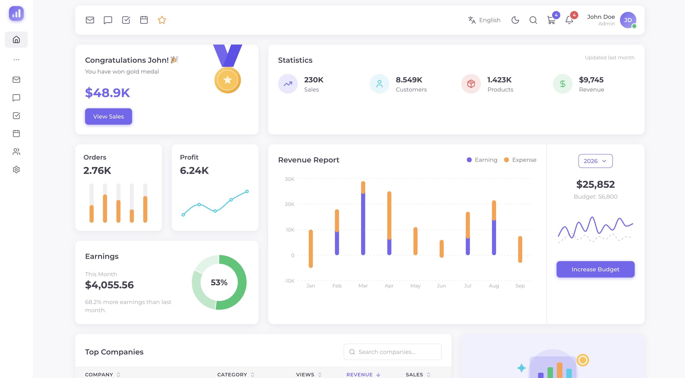
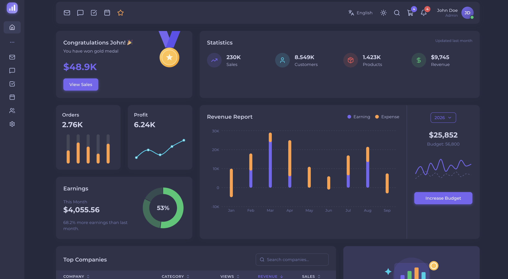
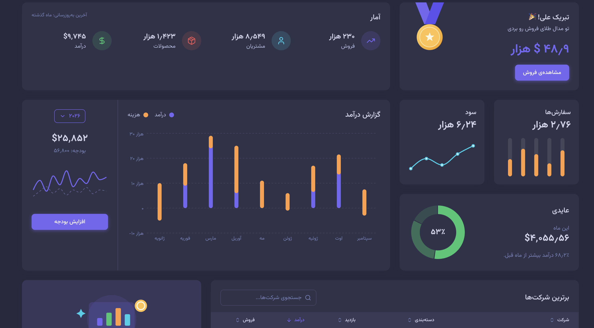
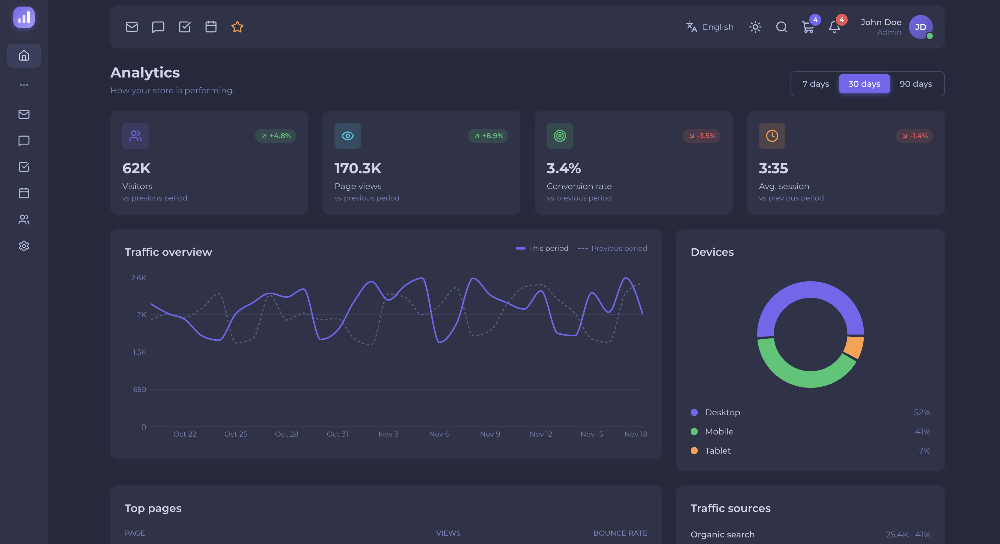

# Dashly Admin

A responsive, bilingual (English / Persian with full RTL) admin dashboard built with **React, Vite and Tailwind CSS v4**, backed by a **Laravel REST API** ([dashly-api](https://github.com/aida20051383/dashly-api)).

**Live demo:** _add your Vercel link here_

> Demo sign-in: `admin@dashly.dev` / `admin123` (admin) or `sara@dashly.dev` / `sara12345` (editor). The login page has a "Fill in" button.

## Screenshots

| Light | Dark |
| ----- | ---- |
|  |  |

| Persian (RTL) | Analytics |
| ------------- | --------- |
|  |  |

## Features

- **eCommerce dashboard** with statistics, orders / profit / earnings widgets, a revenue report chart with year selector, a persisted "increase budget" form (admin only), a companies table and a sales goal card
- **Analytics** with 7 / 30 / 90 day ranges, KPI cards with period-over-period change, a visitors chart, and traffic source, device, country and top page breakdowns
- **Users management**: server-side search, role and status filters, sortable columns, pagination, and create / edit / delete with validation and duplicate-email errors (writes are admin only)
- **Todo**: priorities, due dates, filters, complete / edit / delete
- **Calendar** with category-colored events, month navigation and Jalali (Persian) dates
- **Email**: folders (inbox, starred, sent, trash), read / unread, star, move to trash and restore, compose, and search
- **Chat**: conversation list with unread badges, message history, search and simulated replies
- **Authentication**: token login with validation, "remember me" (localStorage vs sessionStorage), protected routes that return you to the page you came from, and sign-out
- **Profile**: edit personal info with dirty-state detection, change password with current-password check
- **Settings**: theme, language and notification preferences
- **Header tools**: command-style search (Ctrl/⌘ + K), cart, notifications with read/unread state, bookmarks, language and theme switchers
- **Light / dark theme** and **English / Persian** with automatic RTL layout and Persian (Jalali) date formatting
- Loading skeletons, error states with retry, toasts, and keyboard-accessible controls (ARIA roles, focus states)

## Tech stack

| Area      | Choice                                          |
| --------- | ----------------------------------------------- |
| Framework | React 19 + Vite (JavaScript)                    |
| Styling   | Tailwind CSS v4 with CSS-variable design tokens |
| Routing   | React Router v7 (nested routes, route guards)   |
| Data      | TanStack Query v5 over a small fetch client     |
| Backend   | Laravel 13 REST API (Sanctum tokens, MySQL)     |
| Charts    | Recharts                                        |
| i18n      | i18next + react-i18next (en / fa, RTL)          |
| Icons     | lucide-react                                    |

## Architecture

```
src/
  app/          providers (theme, toast), router
  components/
    layout/     sidebar, navbar, shell
    ui/         shared primitives (Card, Modal, Dropdown, Switch, TextField ...)
  config/       navigation (single source of truth for sidebar and search)
  features/     one folder per feature: api / hooks / components / pages
    auth/ dashboard/ analytics/ users/ todo/ calendar/ email/ chat/
    profile/ settings/ cart/ notifications/ search/
  hooks/        useLocalStorage, useDebouncedValue
  i18n/         setup and locale files
  lib/          http client, ApiError, formatting, helpers, query client
```

Design decisions worth noting:

- **One thin API layer.** Every feature talks to async functions in its own `api/` folder, which call a shared `http()` client (`lib/http.js`). It adds the bearer token, maps backend error codes (`NOT_FOUND`, `FORBIDDEN`, `VALIDATION_ERROR`, `NETWORK_ERROR` ...) to a single `ApiError`, and signs the user out on an expired token. TanStack Query hooks sit on top, so components never know about URLs.
- **Built mock-first.** The UI was first developed against in-memory mock APIs with realistic latency, filtering and error codes, then switched to the real backend by rewriting only the `api/` files. Components and hooks did not change.
- **Theming through CSS variables.** Components use semantic utilities (`bg-card`, `text-heading`, `border-border`), and dark mode swaps the variables, so components rarely need `dark:` classes.
- **RTL by design.** Layout uses logical properties (`ps-`, `ms-`, `start-`) and the `rtl:` variant; charts are rendered in an LTR container so axes stay correct.
- **Accessible UI.** Sortable tables expose `aria-sort`, switches use `role="switch"`, form errors use `role="alert"` and are linked with `aria-describedby`.

## Getting started

You need the API running first. Follow the setup steps in the [dashly-api README](https://github.com/aida20051383/dashly-api), which seeds the demo accounts and starts the server on `http://127.0.0.1:8010`.

Then, for the frontend:

```bash
git clone https://github.com/aida20051383/dashly-admin.git
cd dashly-admin
cp .env.example .env
npm install
npm run dev
```

`.env` contains the API address:

```
VITE_API_URL=http://127.0.0.1:8010/api
```

Build for production with `npm run build` and preview it with `npm run preview`.

## Notes

- Analytics and most dashboard widgets show generated demo data, because there is no real tracking or sales source. Everything else (users, todos, calendar, email, chat, budget, profile) is stored in the database and isolated per user.
- Sign-in sessions are stored in the browser.
- The visual style is inspired by modern admin templates. All code, the logo and the illustrations are original.
